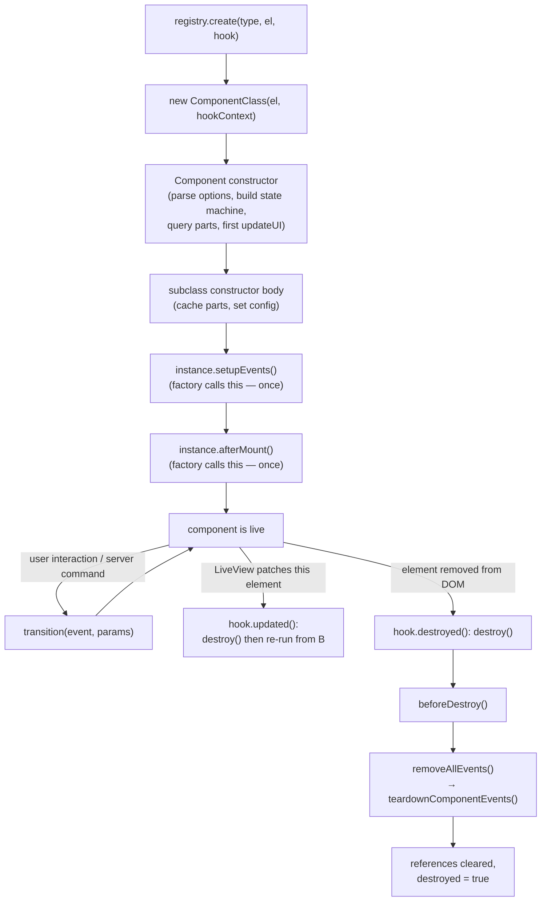
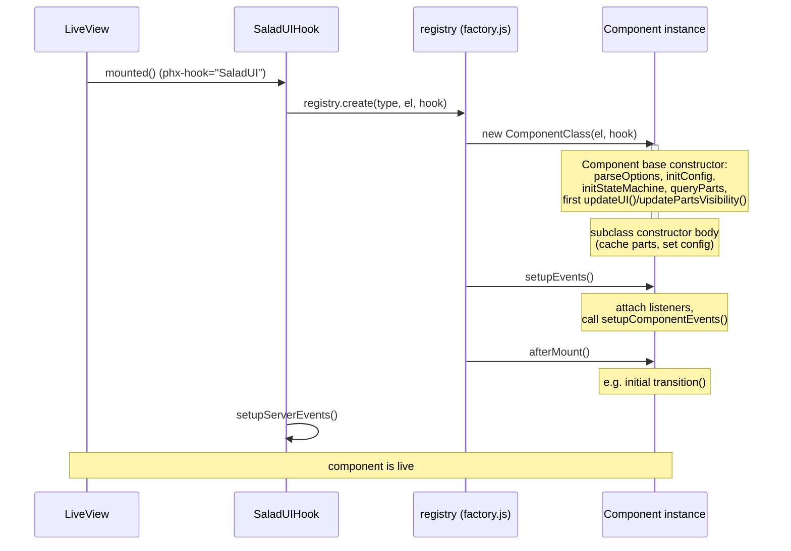
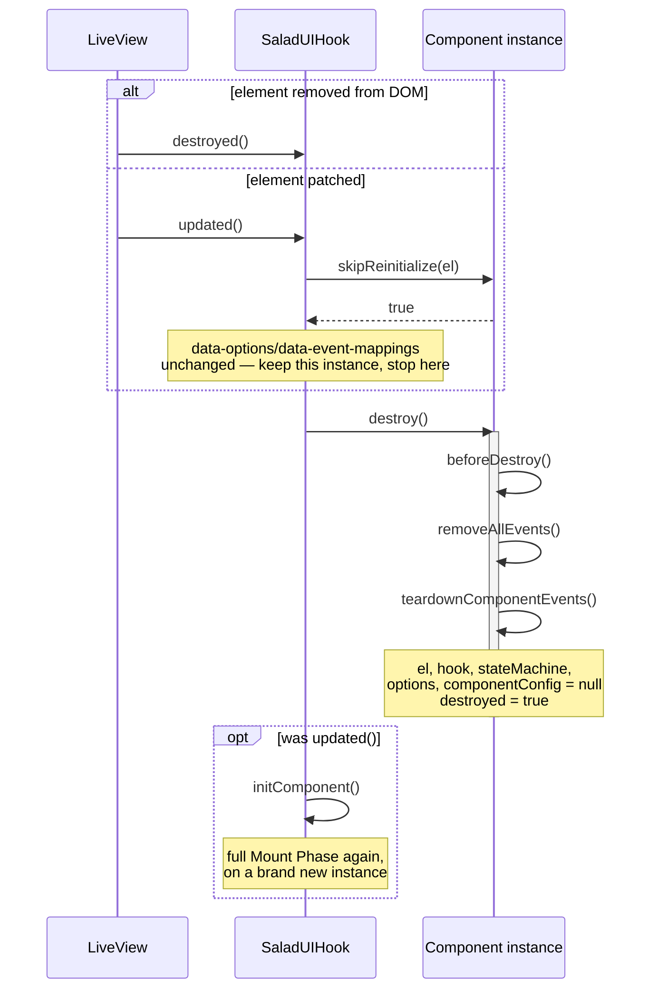

# Component Lifecycle

The authoritative reference for how a SaladUI JavaScript component is created,
wired up, transitions between states, and torn down — and which hooks a
component subclass should use for each phase.

This document focuses on the object lifecycle of `Component`
(`assets/salad_ui/core/component.js`). For the mechanics of state
transitions themselves (exit → state update → animation → enter), see
[State Machine Flow](js_state_transition_flow.md). For the wider system
(registry, factory, LiveView hook), see
[Architecture Overview](js_architecture_overview.md).

## Table of Contents

1. [Overview Diagram](#overview-diagram)
2. [Mount Phase](#mount-phase)
3. [Runtime: State Transitions](#runtime-state-transitions)
4. [Update Phase (LiveView Patch)](#update-phase-liveview-patch)
5. [Destroy Phase](#destroy-phase)
6. [Extension Hook Reference](#extension-hook-reference)
7. [Rules](#rules)
8. [Worked Example: DialogComponent](#worked-example-dialogcomponent)
9. [Common Pitfalls](#common-pitfalls)

## Overview Diagram



Two calls — `setupEvents()` and `afterMount()` — are made **exactly once**,
by `factory.js`, immediately after construction. A component subclass never
calls either of these on itself; see [Rules](#rules) for why that matters.

## Mount Phase



### 1. Base constructor (`Component` itself)

Runs when `new ComponentClass(el, hookContext)` is called by
`registry.create()`. In order:

1. `parseOptions()` — reads `data-options` and `data-state` off `el`.
2. `initEventMappings()` — reads `data-event-mappings`, binds
   `onClientCommand` and `handleActionClick` **once** (these bound
   functions are reused for the lifetime of the instance — see
   [Rules](#rules)).
3. `initConfig()` — calls the subclass's `getComponentConfig()` and fills
   in `stateMachine` / `events` / `hiddenConfig` / `ariaConfig` defaults.
4. `initStateMachine()` — creates the `StateMachine` instance.
5. `new AriaManager(this, this.ariaConfig)`.
6. `queryParts()` — walks the DOM for `data-part` elements, filtering out
   `item`/`*-item` parts unless `ignoreItems: false` was passed.
7. `updateUI()` + `updatePartsVisibility()` — a first, **un-animated**
   render of the initial state (sets `data-state`, ARIA attributes, and
   part visibility).

No DOM event listeners exist yet at the end of this step.

### 2. Subclass constructor body

Runs after `super(el, options)` returns. This is where a subclass caches
its own parts (`this.getPart(...)`) and sets `this.config.preventDefaultKeys`.
**Do not call `this.setupEvents()` or trigger a transition here** — the
factory (or the item's own constructor, for manually-instantiated
sub-parts — see [Rules](#rules)) is responsible for that.

### 3. `setupEvents()` — called once, by the factory

Attaches the listeners every component needs:

- `salad_ui:command` listener → `onClientCommand`
- `click` listener → `handleActionClick` (drives `data-action`)
- key listeners from `events[state].keyMap`
- mouse listeners from `events[state].mouseMap`
- calls the overridable `setupComponentEvents()` hook

### 4. `afterMount()` — called once, by the factory, right after `setupEvents()`

No-op by default. Override it for anything that needs both the
subclass's own fields *and* live listeners — the canonical case is
`DialogComponent` performing its initial `open`/`close` transition (see
[Worked Example](#worked-example-dialogcomponent)).

## Runtime: State Transitions

Once mounted, all behavior flows through `component.transition(event, params)`,
which delegates to the `StateMachine`. See
[State Machine Flow](js_state_transition_flow.md) for the exact
exit-handler → state-update → `onStateChanged` → (animation) →
enter-handler sequence, and the [Architecture Overview](js_architecture_overview.md#data-flow)
for how transitions get triggered (server command, DOM click via
`data-action`, or a `mouseMap`/`keyMap` entry).

Note: `Component.onStateChanged(prevState, nextState)` only declares two
parameters. The state machine also passes `params` as a third argument,
but the base implementation doesn't use it — if you override
`onStateChanged`, you may add a third parameter to read it.

## Update Phase (LiveView Patch)

`SaladUIHook.updated()` does **not** re-run the mount phase on the existing
instance — by default it fully destroys and recreates the component:

```javascript
updated() {
  if (this.component.skipReinitialize(this.el)) return;

  this.component.destroy();
  this.component = null;
  this.initComponent(); // → registry.create() → full mount phase again
}
```

This means every LiveView patch to a component's root element — even an
unrelated one — runs the full destroy phase and then the full mount phase
again, on a brand new instance. Components remount from server-rendered
attributes; client-only state does not survive a patch unless the server also
renders that state.

This matters because LiveView widens change-tracking whenever `@flash`
changes anywhere on the page, patching hooked elements even when their own
`data-options`/`data-event-mappings` are unchanged. `Component.skipReinitialize(el)`
is the escape hatch: defaults to `false` (always reinitialize), but a
subclass can return `true` to keep the current instance when the patch
didn't change anything it reads. `ToastComponent` overrides it to compare
`el.dataset.options`/`el.dataset.eventMappings` against the raw strings the
instance was built with.

`skipReinitialize` only protects the JS instance, not the DOM — LiveView's
diff/patch runs *before* `updated()` fires, so the same flash-triggered patch
can also morph a component's server-rendered children back to their (empty)
template, independent of whether the hook rebuilds. That's why `toaster/1`
additionally renders with `phx-update="ignore"`, so LiveView never diffs its
content after mount. `data-*` attributes on an ignored element still update
live (non-`data-*` ones don't) — `ToastComponent`'s constructor relies on
that to keep `position` changes working despite the freeze.



## Destroy Phase

Triggered by `hook.destroyed()` (element removed from DOM) or by
`hook.updated()` before recreating the component — see the sequence
diagram above for how the two paths diverge after `destroy()` completes:

1. `beforeDestroy()` — subclass cleanup that needs `this.el`/parts/hook
   still valid (e.g. deactivating a `FocusTrap`).
2. `removeAllEvents()`:
   - removes the `salad_ui:command` and `click` listeners
   - removes all key/mouse listeners
   - calls `teardownComponentEvents()` — tear down anything created in
     `setupComponentEvents()`
3. References cleared (`el`, `hook`, `stateMachine`, `options`,
   `componentConfig` set to `null`), `destroyed = true`.

## Extension Hook Reference

| Hook | Called by | Called when | Pairs with |
|---|---|---|---|
| `getComponentConfig()` | `initConfig()` | Once, during construction | — must return a **fresh object** each call, see [Rules](#rules) |
| `setupComponentEvents()` | `setupEvents()` | Once, by the factory, after construction | `teardownComponentEvents()` |
| `afterMount()` | factory, after `setupEvents()` | Once, after construction | `beforeDestroy()` (loosely — not a strict pair, but both are the two lifecycle hooks a subclass most commonly overrides) |
| `teardownComponentEvents()` | `removeAllEvents()` | On `destroy()`, and again if `setupEvents()` is ever re-invoked | `setupComponentEvents()` |
| `beforeDestroy()` | `destroy()` | Once, before listeners are removed | `afterMount()` (see above) |
| `onStateChanged(prev, next)` | `StateMachine` via `initStateMachine()` | Every transition | n/a — override to customize UI update / animation behavior |

## Rules

These aren't stylistic preferences — each one exists because violating it
previously caused a real bug (see [Common Pitfalls](#common-pitfalls)).

1. **`setupEvents()` is called exactly once, by `factory.js`.** Component
   subclasses that are registered via `SaladUI.register(...)` must never
   call `this.setupEvents()` themselves. (This does *not* apply to
   helper classes that are manually instantiated outside the registry —
   e.g. `MenuItem`, `SelectItem`, `AccordionItem`, or the internal `Menu`
   helper — which own their full lifecycle and correctly call
   `setupEvents()` once in their own constructor.)
2. **Every listener/utility created in `setupComponentEvents()` must be
   undone in `teardownComponentEvents()`**, not scattered across state
   enter/exit handlers or only in `beforeDestroy()`. State handlers may
   still *pause/resume* something created here (e.g. `monitor.start()`/
   `monitor.stop()` on open/close) — that's fine — but the thing itself
   must be created and destroyed in the paired setup/teardown hooks.
3. **`getComponentConfig()` must return a new object literal every call.**
   `bindStateHandlers()` mutates the returned `stateMachine` config in
   place (binding string handler names to instance methods). A shared/
   cached config object would leak bound handlers across instances.
4. **Don't do one-time listener setup or transitions in the constructor.**
   Constructor code runs before `setupEvents()`, so nothing you attach
   there is part of the tracked listener set, and no listeners exist yet
   for an in-constructor `transition()` call to rely on.

## Worked Example: DialogComponent

`assets/salad_ui/components/dialog.js` is the canonical example of using
`afterMount()` and `teardownComponentEvents()` correctly:

```javascript
class DialogComponent extends Component {
  constructor(el, hookContext) {
    super(el, { hookContext, initialState: "closed" });

    // Only cache fields here — no setupEvents(), no transition().
    this.root = this.el;
    this.content = this.getPart("content");
    this.contentPanel = this.getPart("content-panel");
    this.config.preventDefaultKeys = ["Escape"];
  }

  afterMount() {
    const requestedState =
      this.el.dataset.open === undefined
        ? this.el.dataset.state || "closed"
        : this.el.dataset.open === "true"
          ? "open"
          : "closed";

    if (requestedState === this.state) {
      if (this.state === "open") {
        this.onOpenEnter();
      }
      return;
    }

    this.transition(requestedState === "open" ? "open" : "close");
  }

  setupComponentEvents() {
    super.setupComponentEvents();
    if (this.options.closeOnOutsideClick) {
      this.setupOutsideClickDetection();
    }
  }

  setupOutsideClickDetection() {
    this.clickOutsideMonitor = new ClickOutsideMonitor([this.contentPanel], (event) => {
      if (event.target === this.content || event.target.dataset.part === "overlay") {
        this.transition("close");
      }
    });
  }

  teardownComponentEvents() {
    super.teardownComponentEvents();
    // Paired with setupOutsideClickDetection() above.
    this.clickOutsideMonitor?.destroy();
    this.clickOutsideMonitor = null;
  }

  onOpenEnter() {
    // start()/stop() just pause/resume the monitor created above —
    // they don't create or destroy it.
    this.clickOutsideMonitor?.start();
    this.pushEvent("open");
  }

  onClosedEnter() {
    this.clickOutsideMonitor?.stop();
    // ...
  }

  beforeDestroy() {
    // Focus trap cleanup belongs here: it isn't something
    // setupComponentEvents() created, so it doesn't belong in
    // teardownComponentEvents().
    this.focusTrap?.destroy();
    this.focusTrap = null;
  }
}
```

## Common Pitfalls

### Leaking a listener by calling `setupEvents()` more than once

Before `afterMount()` existed, `DialogComponent` called `this.setupEvents()`
directly in its constructor (to guarantee listeners were live before its
initial `transition("open")`/`transition("close")` call), and `factory.js`
*also* called `setupEvents()` right after construction — so every dialog
mount ran `setupComponentEvents()` twice.

`setupEvents()` does call `removeAllEvents()` before re-attaching on a
repeat invocation, but at the time `removeAllEvents()` only tore down the
base class's own tracked listeners. It had no way to reach a
`ClickOutsideMonitor` a subclass had created and, if the dialog was
already open, *started* (attaching a `document`-level `click`/`touchend`
listener). The second `setupComponentEvents()` call then overwrote
`this.clickOutsideMonitor` with a brand-new, unstarted instance — orphaning
the first one while it was still actively listening on `document`. From
then on:

- `onClosedEnter()`'s `clickOutsideMonitor.stop()` targeted the *new*
  (never-started) instance, so it was a no-op — the orphaned instance
  kept listening forever.
- Every LiveView `updated()` on an open dialog repeated the whole
  sequence, accumulating another leaked `document` listener.

This is exactly why `setupEvents()` must be called exactly once (Rule 1)
and why `setupComponentEvents()`/`teardownComponentEvents()` must stay
paired (Rule 2) — the fix was introducing `afterMount()` so the dialog no
longer needs to self-invoke `setupEvents()`, and moving the monitor's
cleanup into `teardownComponentEvents()` so it's torn down correctly even
if `setupEvents()` is ever legitimately re-run.
